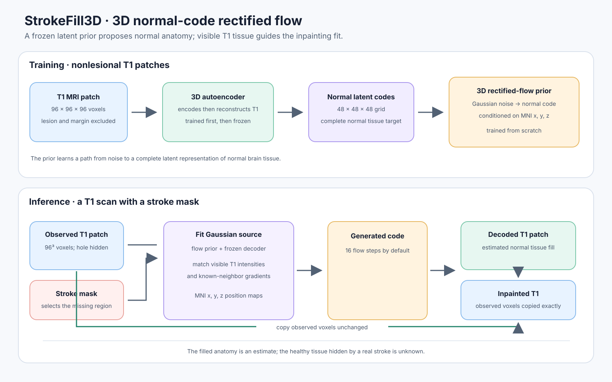
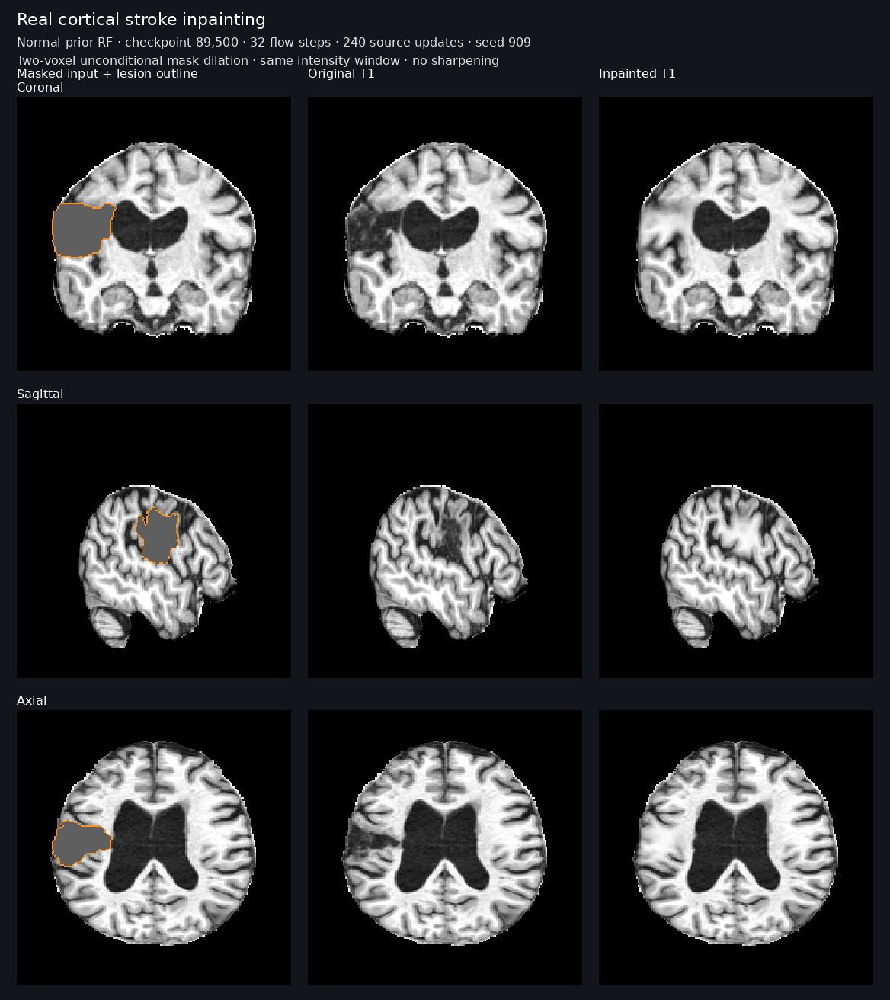

# StrokeFill3D

StrokeFill3D is research software for filling missing regions in 3D T1 brain MRI. It uses a 3D autoencoder and a rectified-flow model trained to generate latent codes for normal brain tissue. During inpainting, the model fits its generated anatomy to the visible MRI around a stroke mask. The fill is an estimate; the healthy anatomy hidden by a real stroke is unknown.

## Model overview

The autoencoder compresses each 96³ MRI patch to a 48³ latent grid. A rectified-flow prior learns to generate complete normal-tissue codes from Gaussian noise, using MNI position as a location cue. At inference, the initial noise is adjusted to match visible MRI intensities and neighboring gradients. A frozen decoder turns the fitted code into an MRI patch, and observed voxels are copied back unchanged.



## Example result

This real cortical-stroke example compares the masked input, original T1, and inpainted T1 in coronal, sagittal, and axial views. It uses a saved checkpoint, two-voxel mask dilation, 32 flow steps, and 240 source-fitting updates. The larger inference budget reduced the visible-context fitting error but did not clearly sharpen cortical folds. The original tissue inside the lesion is unavailable for comparison.



More about the example and how to run inference: [real-stroke guide](docs/REAL_STROKE_EXAMPLE.md).

## Training on an NVIDIA GPU

The full training instructions target a computer with an **NVIDIA GeForce RTX 4090 graphics card (GPU)**. The model uses 96³ MRI patches. Smaller GPUs can run the software preflight but may not have enough memory or speed for full training. The guide explains installation, data setup, preflight, training, resume, validation, and inference: [4090 training guide](docs/NORMAL_PRIOR_4090.md).

The basic setup is:

```bash
python -m venv .venv
source .venv/bin/activate
# Install a CUDA-enabled PyTorch 2.6 wheel compatible with the installed NVIDIA driver.
python -m pip install -e .
```

Set `STROKEFILL_DATA_ROOT` to the directory containing authorized MRI data and manifests. The preflight command checks execution; it uses untrained weights and does not produce a quality result.

```bash
export STROKEFILL_DATA_ROOT=/path/to/data
bash scripts/train_normal_prior_4090.sh /tmp/normal_prior_preflight --preflight
```

## Data and validation

MRI scans, lesion masks, manifests, and trained model weights are not included. Dataset preparation and access requirements are described in the [data guide](docs/DATA.md). The training pipeline excludes real lesion regions from its normal-tissue targets and keeps a subject-level test set separate from training and validation.

The software and training stages have functional checks, but trained 3D anatomical quality remains under evaluation. Plausible folds should not be interpreted as the patient's recovered pre-stroke anatomy. See [the 2D development results](docs/NORMAL_CODE_RF_2D_20261126.md) and [the quality review](docs/2D_QUALITY_GATE_20261126.md) for earlier results and limitations.

## Further documentation

- [3D training and inference on an NVIDIA RTX 4090](docs/NORMAL_PRIOR_4090.md)
- [External T1 and TBI preprocessing and inference](docs/EXTERNAL_DATA.md)
- [Data staging and manifests](docs/DATA.md)
- [Real cortical-stroke inference example](docs/REAL_STROKE_EXAMPLE.md)
- [2D prototype](experiments/normal_code_rf_2d/README.md)

Licensed under Apache-2.0. Research software; not validated for clinical decisions.
