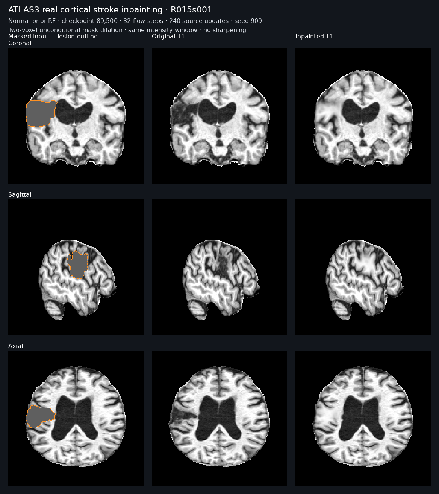

# Real ATLAS3 cortical stroke example

This example applies the normal-code rectified-flow model to the ATLAS3 case R015s001 using the real T1 lesion mask. It documents one inference result, not a clinical evaluation or evidence that the hidden pre-stroke anatomy has been recovered.



The figure shows the masked input with the two-voxel dilated lesion boundary, original T1, and inpainted T1 in coronal, sagittal, and axial views. Display uses one shared 1st–99th percentile intensity window and nearest-neighbor enlargement, with no sharpening. The inference preserved image values outside the dilated mask exactly.

The result used the 96³ normal-prior model at RF checkpoint step 89,500, Gaussian source seed 909, 32 Euler flow steps, 240 source-fitting updates, and two voxels of unconditional mask dilation. These settings were used to compare with the same checkpoint at 16 steps and 120 updates. The larger inference budget reduced the observed-context fitting MSE from 0.0119 to 0.0066, but did not produce a clear visual improvement in fine sulcal detail. There is no healthy ground-truth MRI under the real lesion, so a quantitative reconstruction score for the hidden tissue is unavailable.

## Run inference

First train a run or point `RUN` to an existing run directory that contains the paired `codec.pt` and RF checkpoints. Register the T1 and lesion mask to the same axis-aligned, 1-mm MNI RAS grid before inference; this command does not register or resample inputs. The checkpoint must have been trained with the codec in `RUN`.

```bash
cd /path/to/StrokeFill3D
source .venv/bin/activate

RUN=/path/to/normal_prior_run
T1=/path/to/MNI_T1.nii.gz
MASK=/path/to/MNI_lesion_mask.nii.gz
CHECKPOINT="$RUN/prior/best.pt"

python -m strokefill3d.normal_prior.infer \
  --run "$RUN" \
  --checkpoint "$CHECKPOINT" \
  --image "$T1" \
  --mask "$MASK" \
  --output /path/to/inpainted_T1.nii.gz \
  --mni \
  --flow-steps 32 \
  --iterations 240
```

`--mni` is required and acknowledges that the supplied files are already aligned to the expected MNI grid. Defaults are CUDA inference, 16 flow steps, 120 source-fitting updates, seed 909, and two-voxel unconditional dilation. Override those settings only when desired. Each connected mask component must fit within a 96³ window with at least eight voxels of observed context on every side; larger components fail explicitly. The output NIfTI is in the source T1 intensity units and is accompanied by a JSON sidecar recording checkpoint and inference settings.

The screenshot is provided as a documentation example. The NIfTI source, lesion mask, output volume, and trained checkpoint are not distributed with this repository; ATLAS3 access and use remain subject to the dataset terms.
